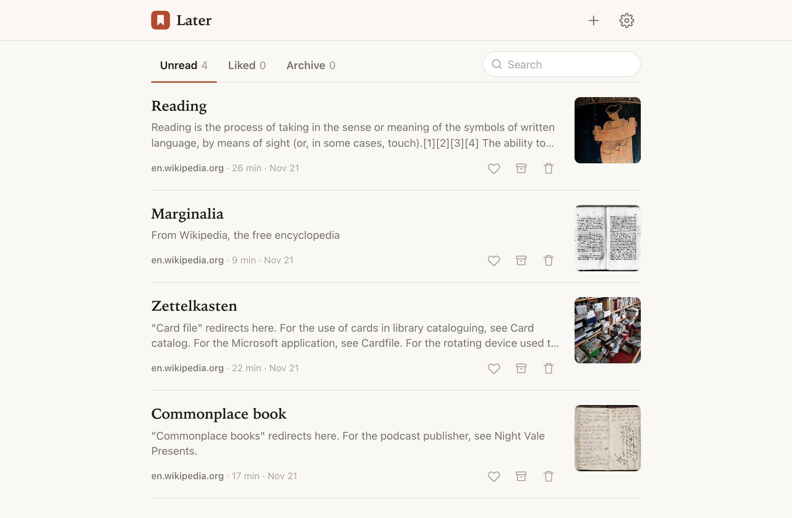
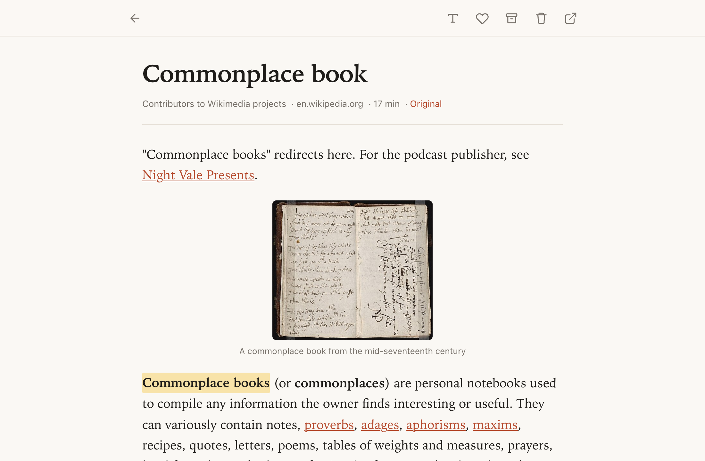

# Later

A read-it-later app you host yourself, for one person: you. Save articles from
Chrome or the iPhone/iPad share sheet, read them in a clean reader on any
device, highlight what matters, and keep those highlights as Markdown files in
your Dropbox.

It runs on Netlify's free plan. There is no database to set up, no build step,
and no subscription.

## What you get

- **Reader:** unread / liked / archive lists, search, light, sepia and dark themes, serif or sans, adjustable text size, reading progress.
- **Offline:** add it to your home screen and articles you've loaded stay readable without a connection.
- **Chrome extension:** one click, `Option+Shift+S`, or right-click a link. It sends the page as you see it, so articles behind a login you have are captured too.
- **iPhone and iPad:** a "Save to Later" entry in the share sheet, installed as an Apple Shortcut. No App Store, no developer account.
- **Save by email:** forward a link or a whole newsletter to an address on your own domain (optional, needs a few DNS records).
- **Highlights and notes:** select text to highlight, tap a highlight to add a note. Optionally synced to a Dropbox folder as one Markdown file per article, with front matter that suits Obsidian.
- **Import and export:** bring in an Instapaper CSV export, or any list of links; export your library as JSON.

## Set it up

You need a free [Netlify](https://www.netlify.com) account. About five minutes.

1. **Deploy your own copy.**

   

   Or from a terminal:

       git clone https://github.com/glenlubbert/later.git
       cd later
       npm install
       npx netlify-cli login
       npx netlify-cli deploy --prod     # choose "Create & configure a new project"

2. **Choose your password.** Open your new site straight away. The first visit asks you to set the password that protects the library. Until you do, anyone who finds the address could set it instead, so don't leave this step for later.

3. **Optional: use your own domain.** In Netlify, open the project's Domain management page and add a domain such as `read.example.com`, then create the DNS record it shows you. HTTPS is issued automatically.

4. **Install the savers.** Everything is under the gear icon on your site:
   - **Chrome:** download the extension, unzip it, open `chrome://extensions`, switch on Developer mode, click *Load unpacked*, pick the folder, and enter your site's address when it asks.
   - **iPhone / iPad:** open your site on the device, create a token, tap *Get the shortcut*, and give it your site's address and the token.
   - **Any other browser:** drag the bookmarklet to your bookmarks bar.

### Highlights to Dropbox (optional)

Later writes to Dropbox through an app that you create in your own Dropbox account, so nobody else is in the loop.

1. At [dropbox.com/developers/apps](https://www.dropbox.com/developers/apps/create) create an app: *Scoped access*, then *Full Dropbox* (or *App folder* if you're happy with files under `/Apps/<app name>`).
2. On its Permissions tab tick `files.content.write` and save.
3. On its Settings tab add the redirect URI `https://YOUR-SITE/api/dropbox/callback`.
4. On your Later site, under the gear icon, paste the **App key** (never the secret), choose a folder, and click *Connect Dropbox*.

Each highlighted article becomes `<folder>/<Article title>.md`. The file is rewritten whenever its highlights change and removed when the last highlight is.

### Save by email (optional)

Forward an email to your own address and it lands in your list: a message that is mostly a link saves that page, anything longer (a newsletter, say) is saved as an article itself.

Mail is received by [Forward Email](https://forwardemail.net), which is free for this and needs no account. It hands each message to your site.

1. Pick a subdomain that is used for nothing else, for example `in.example.com`, and add three DNS records for it (name `in`):
   - `MX`, priority 0, `mx1.forwardemail.net`
   - `MX`, priority 0, `mx2.forwardemail.net`
   - `TXT`, `forward-email=save:https://YOUR-SITE/api/inbound?attachments=false&raw=false`
2. In your site's settings, under **Email**, enter the address (`save@in.example.com`) and add the address you will forward from.

On Forward Email's free plan the address is publicly discoverable, so Later only saves a message when it arrives from Forward Email's servers, is from a sender you listed, and passes that sender's DMARC, SPF or DKIM check. Everything else is dropped.

## Good to know

- **One user.** There are no accounts; one password guards one library.
- **Where your data lives.** Articles, highlights and the password hash are stored in [Netlify Blobs](https://docs.netlify.com/build/data-and-storage/netlify-blobs/) inside your own Netlify project. Nothing is sent anywhere else, apart from fetching the pages you save and, if you connect it, your Dropbox.
- **Sites that block robots.** Saves from the share sheet or the "+" button are fetched by the server, and some sites refuse that. The page is still saved as a link. The Chrome extension avoids the problem because it sends what your browser already loaded.
- **PDFs and videos** are saved as links, without a reader view.
- **Forgot the password?** Run `npx netlify-cli blobs:delete later auth` in the project folder. The site then asks for a new password; your articles are untouched.

## How it's built

| Part | Where | Notes |
| --- | --- | --- |
| Web app | `public/` | Plain HTML, CSS and JavaScript. Service worker for offline reading. |
| API | `netlify/functions/api.mjs` | One Netlify Function serving `/api/*`. |
| Article extraction | `netlify/lib/extract.mjs` | Mozilla Readability on linkedom, then an allow-list HTML sanitizer. |
| Storage | `netlify/lib/store.mjs` | Netlify Blobs: an index, one blob per article body, one per article's highlights. |
| Sign-in | `netlify/lib/auth.mjs` | scrypt password hash, long-lived session cookie, revocable API tokens. |
| Highlights and Dropbox | `netlify/lib/highlights.mjs`, `netlify/lib/dropbox.mjs` | OAuth with PKCE, so no Dropbox secret is stored. |
| Chrome extension | `extension/` | Manifest V3. Asks only for access to the one site you name. |
| iOS Shortcut | `scripts/make_shortcut.py` | Builds and signs `public/later.shortcut` (needs macOS). |

### Develop

    npm install
    npm run dev          # http://localhost:8899 with a throwaway local data store

    npm run zip          # rebuild the extension download after changing extension/
    npm run shortcut     # rebuild the Shortcut (macOS)
    npm run deploy       # deploy the linked Netlify project

## Author

Built by [Glen Lubbert](https://glenlubbert.com) as a personal replacement for a paid read-it-later subscription.

## License

MIT. See [LICENSE](LICENSE).
